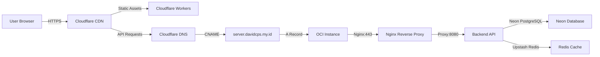
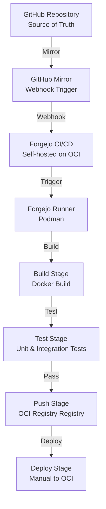

# Infrastructure & Network Architecture

**Version**: 1.0
**Date**: 2026-11-09
**Status**: Draft

---

## Overview

This document describes the cloud topology, network architecture, and CI/CD pipeline for the Advanced Task Manager project.

---

## Cloud Topology

### Infrastructure Diagram

```mermaid
graph TB
    subgraph "Cloudflare Edge Network"
        CDN[Cloudflare CDN<br/>300+ Global Locations]
        Workers[Cloudflare Workers<br/>Edge Functions]
        DNS[Cloudflare DNS<br/>Dynamic DNS]
    end

    subgraph "Oracle Cloud Infrastructure (OCI)"
        Instance[OCI Instance<br/>A1.Flex 2 OCPU 12GB<br/>Debian 26 LTS]
        Podman[Podman<br/>Container Runtime]
        Nginx[Nginx<br/>Reverse Proxy]
        VMStorage[VM Storage<br/>200GB for Media]
    end

    subgraph "Neon Database"
        NeonProd[(Neon PostgreSQL<br/>Production Branch)]
        NeonTest[(Neon PostgreSQL<br/>Testing Branch)]
        NeonDev[(Neon PostgreSQL<br/>Development Branch)]
    end

    subgraph "Upstash"
        Redis[(Upstash Redis<br/>Global Cache)]
    end

    subgraph "CI/CD Infrastructure"
        Forgejo[Forgejo<br/>Self-hosted CI/CD]
        OCI Registry[OCI Registry<br/>Image Registry]
    end

    CDN -->|Static Assets| Workers
    Workers -->|REST API| Nginx
    DNS -->|A Record: server.davidcps.my.id| Instance
    DNS -->|CNAME Records| CDN
    Nginx -->|Proxy| Podman
    Podman -->|Backend Container| Instance
    Instance -->|File Links| VMStorage
    Instance -->|SQL| NeonProd
    Instance -->|SQL (Tests)| NeonTest
    Instance -->|Cache| Redis
    Forgejo -->|Build & Push| OCI Registry
    Instance -->|Pull Images| OCI Registry
```

### Infrastructure Components

| Component | Provider | Specification | Purpose |
|-----------|----------|---------------|---------|
| **Frontend** | Cloudflare Workers | Edge deployment (300+ locations) | Global low-latency delivery |
| **Backend** | Oracle Cloud Infrastructure | A1.Flex 2 OCPU 12GB RAM | Production API server |
| **Database** | Neon PostgreSQL | Branch-first workflow | Primary data storage |
| **Cache** | Upstash Redis | Global edge cache | Application caching |
| **Media Storage** | OCI VM Storage | 200GB attached storage | Video, photo, media files |
| **CI/CD** | Forgejo (Self-hosted) | On OCI instance | Build, test, deploy pipeline |
| **Container Registry** | OCI Registry | Integrated with GitHub | Docker image storage |
| **DNS** | Cloudflare DNS | Dynamic DNS support | Domain resolution |

---

## Network Architecture

### Domain Structure

```
davidcps.my.id (Root Domain)
├── server.davidcps.my.id (A Record - OCI Instance IP)
│   └── Updated by DDNS (ephemeral IP support)
├── apitaskmanagerv2.davidcps.my.id (CNAME → server.davidcps.my.id)
│   └── Backend API endpoint
├── ci.davidcps.my.id (CNAME → server.davidcps.my.id)
│   └── Forgejo CI/CD UI
└── Frontend deployed to Cloudflare Workers (no subdomain needed)
```

### Network Flow



### SSL/TLS Configuration

**Important: Cloudflare SSL/TLS Mode - Full Strict**

**Current Configuration:**
- **SSL/TLS Mode**: Full (strict)
- **Browser → Cloudflare**: HTTPS (encrypted)
- **Cloudflare → Origin**: HTTPS (encrypted)
- **SSL Certificate**: Let's Encrypt wildcard for `*.davidcps.my.id` and `davidcps.my.id`
- **Certificate Location**: `/etc/letsencrypt/live/davidcps.my.id/fullchain.pem`
- **Certificate Validity**: Valid until 2027-02-04 (auto-renewal via certbot)
- **Nginx SSL termination**: Port 443 with SSL certificate
- **HTTP redirect**: Port 80 redirects to HTTPS

**Why Full Strict Mode?**
- End-to-end encryption (browser → Cloudflare → origin)
- Server must have valid SSL certificate for handshake with Cloudflare
- SSL certificate installed on OCI instance (Nginx container)
- Nginx handles SSL termination and proxies to backend (HTTP 8080)
- Maximum security for production deployment

**SSL Certificate Future Plan:**
- Install Let's Encrypt wildcard certificate on OCI instance
- Certificate: `*.davidcps.my.id` and `davidcps.my.id`
- Upgrade to Full (strict) mode for end-to-end encryption

### Firewall Configuration

**OCI Instance iptables Rules**

Oracle-provided iptables rules block HTTP (port 80) and HTTPS (port 443) by default. After opening ports in OCI Security List/NSG, you must also add iptables rules on the instance.

**Add iptables rules for HTTP/HTTPS:**
- Use iptables to allow ports 80 and 443
- Ensure rules persist across reboots using netfilter-persistent

**Why this is needed:**
- OCI Security List controls VCN-level traffic
- NSG (Network Security Group) controls subnet-level traffic
- iptables controls OS-level traffic on the instance
- All three layers must allow the port for traffic to pass through

---

## Container Platform Strategy

### Strategy Summary

| Environment | Platform | Reason |
|-------------|----------|--------|
| **Development (Windows/macOS)** | Docker Desktop | Best cross-platform support |
| **Development (Linux)** | Docker or Podman | Flexibility for team preference |
| **CI/CD (Forgejo Actions)** | Podman | Consistent with production (OCI) |
| **Production** | OCI Instance (Podman) | Self-managed container runtime |
| **Registry** | OCI Registry | Integrated with GitHub, no signup needed |

### Development Setup

**Windows/macOS (Docker Desktop)**
- Install Docker Desktop from official website
- Verify installation with docker --version
- Start development environment with docker-compose up -d

**Linux (Docker - Recommended)**
- Install Docker using official script
- Add user to docker group
- Verify installation with docker --version
- Start development environment with docker-compose up -d

**Linux (Podman - Optional)**
- Install Podman using package manager
- Optional: Set Docker compatibility aliases
- Use same docker-compose.yml with podman-compose

**Important:** Both Docker and Podman use the same `Dockerfile` and `docker-compose.yml`. OCI standard ensures compatibility.

### Production Deployment

**OCI Instance Configuration**

- **Image Source**: OCI Registry
- **Image**: `ghcr.io/davidtan/taskmanager-backend:latest`
- **Authentication**: GitHub username + PAT or OCI credentials
- **Instance Type**: A1.Flex - 2 OCPUs, 12 GB RAM
- **Container Runtime**: Podman
- **Reverse Proxy**: Nginx

**Manual deployment to OCI Instance:**
- SSH into OCI instance
- Pull latest image from OCI Registry
- Stop and remove old container
- Start new container with appropriate configuration
- Configure Nginx reverse proxy

---

## CI/CD Pipeline

### Forgejo CI/CD Architecture



### CI/CD Workflow

**Trigger:**
- Push to GitHub main/develop branch
- Pull request to GitHub
- GitHub mirrors to Forgejo via webhook
- Forgejo Actions triggers on mirror event

**Stages:**

1. **Build Stage**
   - Checkout code from Forgejo mirror
   - Build Docker image using Podman
   - Tag image with commit SHA

2. **Test Stage**
   - Run unit tests (Go tests)
   - Run integration tests (with Neon testing branch)
   - Generate coverage reports
   - Enforce coverage thresholds

3. **Push Stage**
   - Login to OCI Registry (OCI Registry)
   - Push image to OCI Registry with SHA tag
   - Push image to OCI Registry with latest tag (if main branch)

4. **Deploy Stage**
   - Manual trigger (not automatic)
   - SSH to OCI instance
   - Pull latest image from OCI Registry
   - Restart container with Podman
   - Verify deployment health

### Forgejo Configuration

**Forgejo Environment Variables (docker-compose.yml):**
- Database configuration with Neon PostgreSQL
- Server configuration with domain and ports
- Actions enabled for CI/CD

**Forgejo Database:**
- **Current**: Neon PostgreSQL (`ci-forgejo-oci` project)
- **Neon project**: `CI-FORGEJO-OCI` (muddy-bread-34400791)
- **Database stores**: Users, repos, Actions logs, artifacts
- **Schema**: Created automatically by Forgejo
- **Benefits**: Auto-backup, point-in-time recovery, scalable

**Podman Networking:**
- Shared network: `forgejo-net`
- All containers (forgejo, forgejo-proxy) on same network
- Nginx uses container name to resolve: `proxy_pass http://forgejo:3000`

### GitHub Mirror Configuration

**Setup Steps:**

1. Create repository in Forgejo
2. Repository Settings → Mirroring Settings
3. Add mirror from GitHub: `https://github.com/davidtan/taskmanagerV2`
4. Configure sync interval (every 5 minutes)
5. GitHub webhook triggers mirror sync on push

**Benefits:**
- GitHub remains source of truth
- Forgejo handles CI/CD without GitHub Actions cost
- Automatic sync on push via webhook
- Periodic sync (every 5 minutes) as fallback

---

## Dynamic DNS (DDNS)

### Why DDNS?

The OCI instance has an ephemeral public IP that can change on stop/start. DDNS automatically updates DNS records when the IP changes.

### DDNS Setup

**DDNS Script Location:** `/usr/local/bin/update-cloudflare-dns`

**Configuration:** `/usr/local/bin/update-cloudflare-dns.conf`
```bash
what_ip="external"
dns_record="server.davidcps.my.id"
zoneid="your-zone-id"
cloudflare_zone_api_token="your-api-token"
proxied="false"
ttl=1
```

**Cron Job:**
```bash
*/5 * * * * /usr/local/bin/update-cloudflare-dns > /dev/null 2>&1
```

### DNS Structure for Ephemeral IP

```
server.davidcps.my.id         A  (updated by DDNS)
ci.davidcps.my.id            CNAME  server.davidcps.my.id
apitaskmanagerv2.davidcps.my.id  CNAME  server.davidcps.my.id
api-project2.davidcps.my.id      CNAME  server.davidcps.my.id
... (other projects)
```

**Benefits:**
- One A record (`server`) updated by DDNS
- All other subdomains use CNAME pointing to `server`
- If IP changes, only `server` A record needs update
- All CNAME records automatically follow new IP

---

## Disaster Recovery

### Backup Strategy

**Database Backups (Neon):**
- Automated daily backups (Neon feature)
- Point-in-time recovery (up to 7 days)
- Branch-based isolation (testing branch separate from production)
- No manual backup management required

**Media Storage Backups (VM Storage):**
- 200GB attached storage on OCI instance
- Manual backup to OCI Object Storage (10GB Standard tier)
- Backup frequency: Weekly
- Retention policy: 4 weeks

**Configuration Backups:**
- Nginx configuration: `/etc/nginx/`
- Environment variables: `.env.production` (server only)
- Backup location: OCI Object Storage
- Backup frequency: On change

### Recovery Procedures

**Database Recovery:**
```bash
# Restore from backup via Neon Console
# Or use point-in-time recovery to specific timestamp
# Switch to previous branch if needed
```

**Media Storage Recovery:**
```bash
# Restore from OCI Object Storage
# Copy files back to VM storage
# Update file references in database if paths changed
```

**Configuration Recovery:**
```bash
# Restore Nginx configuration
sudo cp /backup/nginx.conf /etc/nginx/nginx.conf
sudo systemctl reload nginx

# Restore environment variables
cp /backup/.env.production /home/ubuntu/apps/taskmanager/.env.production
```

### Failover Steps

**Database Failover:**
1. Switch to testing branch if production branch fails
2. Redirect application traffic to testing branch
3. Investigate production branch issue
4. Fix and switch back to production branch

**Application Failover:**
1. Monitor health endpoint: `GET /health`
2. If unhealthy, restart container via Podman
3. If container fails, pull latest image from OCI Registry
4. If image fails, rollback to previous image tag
5. If server fails, create new OCI instance and restore from backups

---

## Monitoring & Observability

### Monitoring Stack

**Grafana (Free Tier):**
- Dashboard for application metrics
- Database performance monitoring
- Cache hit rates
- API response times
- Error rates

**Log Aggregation:**
- Application logs: stdout/stderr (collected by Podman)
- Nginx logs: `/var/log/nginx/`
- System logs: `/var/log/syslog`
- Log retention: 30 days

### Health Checks

**Backend Health Endpoint:**
```
GET /health
Response: 200 OK
{
  "status": "healthy",
  "database": "connected",
  "cache": "connected",
  "timestamp": 1726652400000
}
```

**Database Health Check:**
- Connection pool status
- Query performance
- Replication lag (if replicas exist)

**Cache Health Check:**
- Redis connection status
- Memory usage
- Hit/miss ratio

---

## References

- [System Overview](./system-overview.md) - High-level system architecture
- [Security & Compliance](./security-&-compliance.md) - Security architecture
- [Disaster Recovery](./disaster-recovery.md) - Recovery procedures
- [Backend Technical Design](../backend-spec/README.md) - Backend deployment details
- [Frontend Technical Design](../frontend-spec/README.md) - Frontend deployment details
- [Local Setup Guide](../guides/local-setup.md) - Development environment setup
