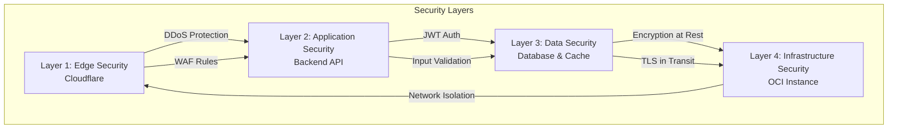
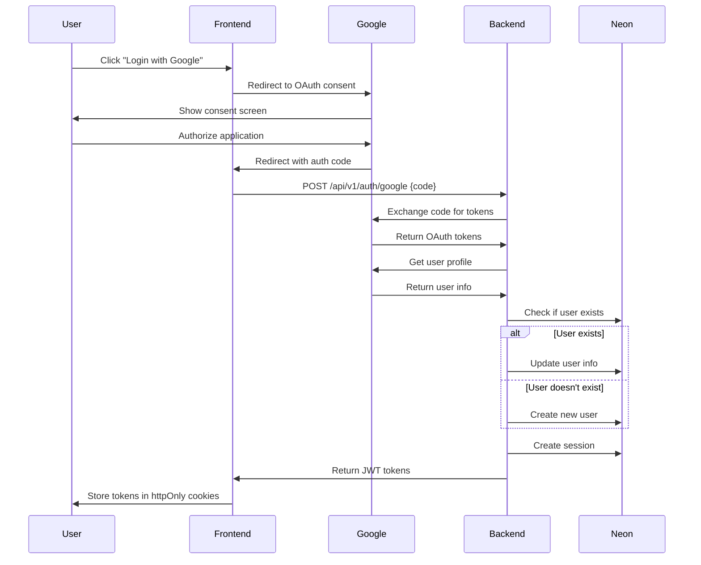
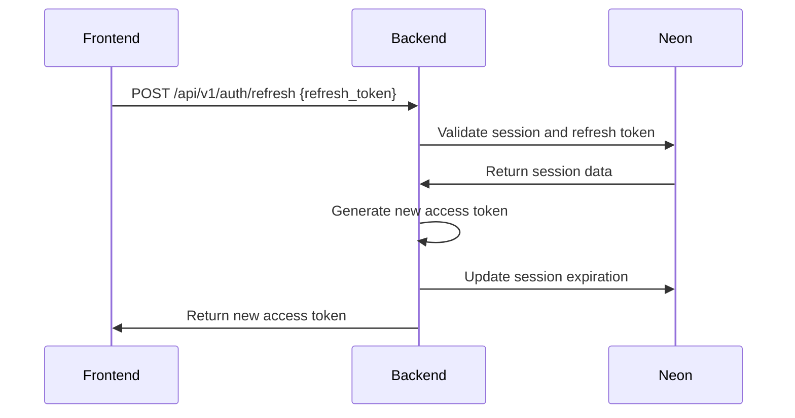

# Security & Compliance

**Version**: 1.0
**Date**: 2026-11-09
**Status**: Draft

---

## Overview

This document describes the security architecture, authentication strategy, data protection measures, and compliance standards for the Advanced Task Manager project.

---

## Security Architecture

### Security Layers

### Security Measures by Layer

| Layer | Security Measures | Purpose |
|-------|-------------------|---------|
| **Edge (Cloudflare)** | DDoS protection, WAF, rate limiting, bot protection | Protect against attacks at edge |
| **Application** | JWT authentication, input validation, XSS protection, CSRF protection | Protect application logic |
| **Data** | Encryption at rest, TLS 1.3 in transit, parameterized queries | Protect data in storage and transit |
| **Infrastructure** | Network isolation, firewall rules, least privilege access | Protect server and resources |

---

## Authentication & Authorization

### Authentication Strategy

**Primary Method:** Google OAuth 2.0

**Why Google OAuth?**
- Industry-standard OAuth 2.0 implementation
- No password management (user responsibility)
- Secure token-based authentication
- Integrated with Google accounts (high adoption)
- Reduced attack surface (no password storage)

### Authentication Flow

### JWT Token Structure

**Access Token (15 minutes expiration):**
- Issuer: taskmanager-api
- Subject: user-id
- Audience: taskmanager-frontend
- Claims: email, name

**Refresh Token (7 days expiration):**
- Issuer: taskmanager-api
- Subject: user-id
- Audience: taskmanager-frontend
- Type: refresh

### Token Storage

**Frontend:**
- Access token: Memory (session storage)
- Refresh token: httpOnly, secure, sameSite cookie

**Backend:**
- Session record in PostgreSQL with refresh token hash
- Token expiration tracking
- Automatic token revocation on logout

### Token Refresh Flow

### Authorization Model

**Role-Based Access Control (RBAC):**

| Role | Permissions |
|------|-------------|
| **Guest** | Create/read/update/delete own tasks (local only, max 50) |
| **Authenticated User** | Full task management, import/export, priority scoring |
| **Admin** | User management, system configuration (future) |

**Resource Ownership:**
- Users can only access their own tasks
- No cross-user data access
- Row-level security in database queries

---

## Data Protection

### Encryption

**Encryption at Rest:**
- Database: Neon PostgreSQL (automatic encryption)
- Cache: Upstash Redis (automatic encryption)
- Media Storage: OCI VM Storage (disk encryption enabled)

**Encryption in Transit:**
- Frontend → Backend: TLS 1.3 (Cloudflare Flexible mode)
- Backend → Database: TLS 1.3 (Neon PostgreSQL)
- Backend → Cache: TLS 1.3 (Upstash Redis)
- API → Google OAuth: TLS 1.3

### Data Classification

| Classification | Data Type | Storage | Access Level |
|----------------|-----------|---------|--------------|
| **Public** | Application metadata, documentation | Public repos | Public |
| **Internal** | Configuration, internal docs | Private repos | Team only |
| **Confidential** | User data, tasks, sessions | Database (Neon) | User + System |
| **Restricted** | API keys, credentials, secrets | Environment variables | System only |

### Data Retention

| Data Type | Retention Period | Deletion Method |
|-----------|------------------|-----------------|
| **User tasks** | Until user deletes account | Hard delete |
| **User sessions** | 7 days (refresh token expiry) | Hard delete |
| **Audit logs** | 90 days | Hard delete |
| **Media files** | Until user deletes | Hard delete |
| **Backups** | 30 days (logs), 4 weeks (media) | Automatic deletion |

### Privacy by Design

**Minimization:**
- Only collect necessary data
- No unnecessary tracking
- Guest mode (no personal data required)

**Transparency:**
- Clear privacy policy
- User data export capability
- User data deletion on request

**User Control:**
- Export all data (JSON/CSV/PDF)
- Delete account and all data
- OAuth revocation (via Google account)

---

## OWASP Compliance

### OWASP Top 10 Mitigation

| OWASP Risk | Mitigation Strategy |
|------------|---------------------|
| **A01: Broken Access Control** | JWT validation, RBAC, ownership checks |
| **A02: Cryptographic Failures** | TLS 1.3, encryption at rest, secure token storage |
| **A03: Injection** | Parameterized queries (SQLBoiler), input validation (Zod) |
| **A04: Insecure Design** | Security-first architecture, threat modeling |
| **A05: Security Misconfiguration** | Hardened images, security headers, no debug in prod |
| **A06: Vulnerable Components** | Dependency scanning, regular updates, SBOM |
| **A07: Authentication Failures** | OAuth 2.0, secure token storage, MFA (future) |
| **A08: Software/Data Integrity** | Signed commits, artifact verification |
| **A09: Logging & Monitoring** | Security event logging, Grafana monitoring |
| **A10: SSRF** | Input validation, network restrictions |

### Security Headers

**Nginx Configuration:**
- X-Frame-Options: SAMEORIGIN
- X-Content-Type-Options: nosniff
- X-XSS-Protection: 1; mode=block
- Referrer-Policy: strict-origin-when-cross-origin
- Content-Security-Policy: default-src 'self'; script-src 'self' 'unsafe-inline'; style-src 'self' 'unsafe-inline'
- Strict-Transport-Security: max-age=31536000; includeSubDomains

### Content Security Policy (CSP)

**Frontend CSP:**
- default-src 'self'
- script-src 'self' 'unsafe-inline' 'unsafe-eval'
- style-src 'self' 'unsafe-inline'
- img-src 'self' data: https:
- connect-src 'self' https://*.googleapis.com
- font-src 'self'
- object-src 'none'
- base-uri 'self'
- form-action 'self'
- frame-ancestors 'none'

---

## Input Validation

### Frontend Validation (Zod)

**Task Creation Schema:**
- Title: string, min 1, max 200
- Description: string, optional
- Status: enum (todo, in-progress, completed)
- Priority: enum (low, medium, high, urgent)
- Due date: number, optional
- Tags: array of strings, optional

### Backend Validation (Go Validator)

**Task Creation Validation:**
- Title: required, min 1, max 200
- Description: max 5000
- Status: required, oneof (todo, in-progress, completed)
- Priority: required, oneof (low, medium, high, urgent)
- Due date: optional, min 0
- Tags: optional, max 10

### SQL Injection Prevention

**Parameterized Queries (SQLBoiler):**
- All database access through SQLBoiler ORM
- Automatic parameterized queries
- No string concatenation in queries
- Input validation before database operations

---

## Rate Limiting

### Rate Limiting Strategy

**Global Rate Limiting:**
- 100 requests per minute per IP
- 1000 requests per hour per IP

**Per-User Rate Limiting:**
- 200 requests per minute per authenticated user
- 2000 requests per hour per authenticated user

**Endpoint-Specific Limits:**
- Authentication endpoints: 10 requests per minute per IP
- Task creation: 60 requests per minute per user
- File upload: 10 requests per minute per user

### Rate Limiting Implementation

**Nginx Configuration:**
- Global rate limiting zone based on IP address
- User-based rate limiting zone
- Burst and nodelay configuration

**Response Headers:**
- X-RateLimit-Limit: Total limit
- X-RateLimit-Remaining: Remaining requests
- X-RateLimit-Reset: Reset timestamp

---

## Compliance Standards

### GDPR Compliance

**Data Subject Rights:**
- Right to access: User can export all data
- Right to rectification: User can update data
- Right to erasure: User can delete account and all data
- Right to portability: Export in JSON/CSV/PDF formats
- Right to object: User can object to data processing

**Lawful Basis for Processing:**
- Consent: User agrees to terms on sign-up
- Contract: Service provision requires data processing
- Legitimate interest: Application functionality

**Data Processing Agreement (DPA):**
- Neon PostgreSQL: DPA included in service
- Upstash Redis: DPA included in service
- Google OAuth: DPA included in service

### SOC 2 Type II Compliance (Future)

**Planned for:**
- Security controls documentation
- Access control logs
- Change management procedures
- Incident response procedures
- Regular security audits

---

## Security Monitoring

### Security Events

**Events to Monitor:**
- Failed authentication attempts
- Brute force attacks
- SQL injection attempts
- XSS attempts
- CSRF attempts
- Rate limit violations
- Unauthorized access attempts
- Data export requests
- Account deletion requests

**Monitoring Stack:**
- Grafana dashboards for security metrics
- Log aggregation (Nginx logs, application logs)
- Alert configuration for critical events

### Incident Response

**Incident Response Plan:**

1. **Detection:**
   - Automated monitoring alerts
   - User reports
   - Security scanning

2. **Containment:**
   - Isolate affected systems
   - Block malicious IPs
   - Revoke compromised tokens

3. **Eradication:**
   - Remove malicious code
   - Patch vulnerabilities
   - Update configurations

4. **Recovery:**
   - Restore from backups
   - Verify system integrity
   - Resume normal operations

5. **Post-Incident:**
   - Document incident
   - Update security measures
   - Conduct root cause analysis

---

## References

- [System Overview](./system-overview.md) - High-level system architecture
- [Infrastructure & Network](./infrastructure-&-network.md) - Network security
- [Disaster Recovery](./disaster-recovery.md) - Recovery procedures
- [OWASP Top 10](https://owasp.org/www-project-top-ten/) - OWASP security standards
- [GDPR](https://gdpr.eu/) - GDPR compliance requirements
