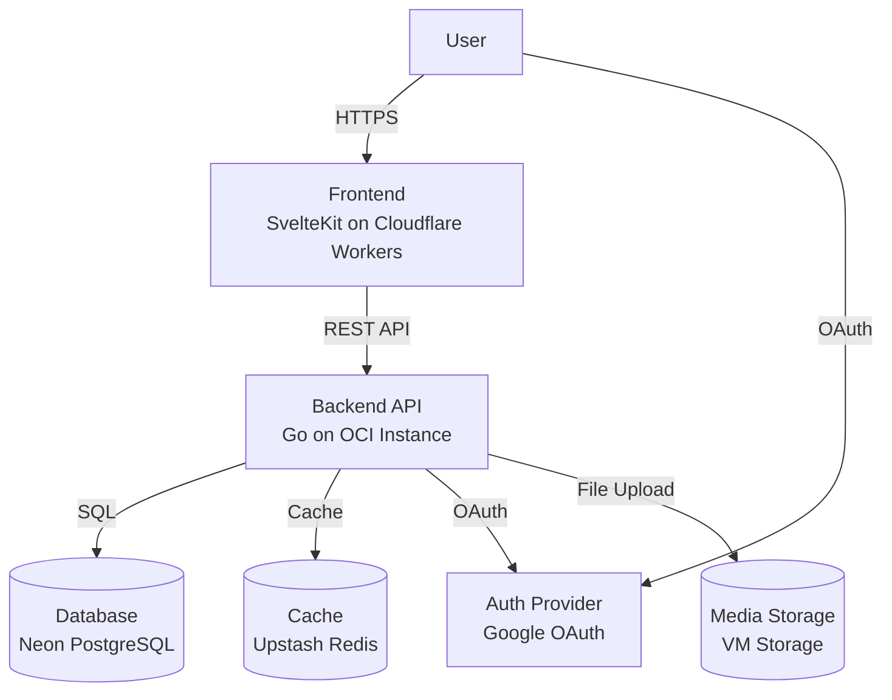
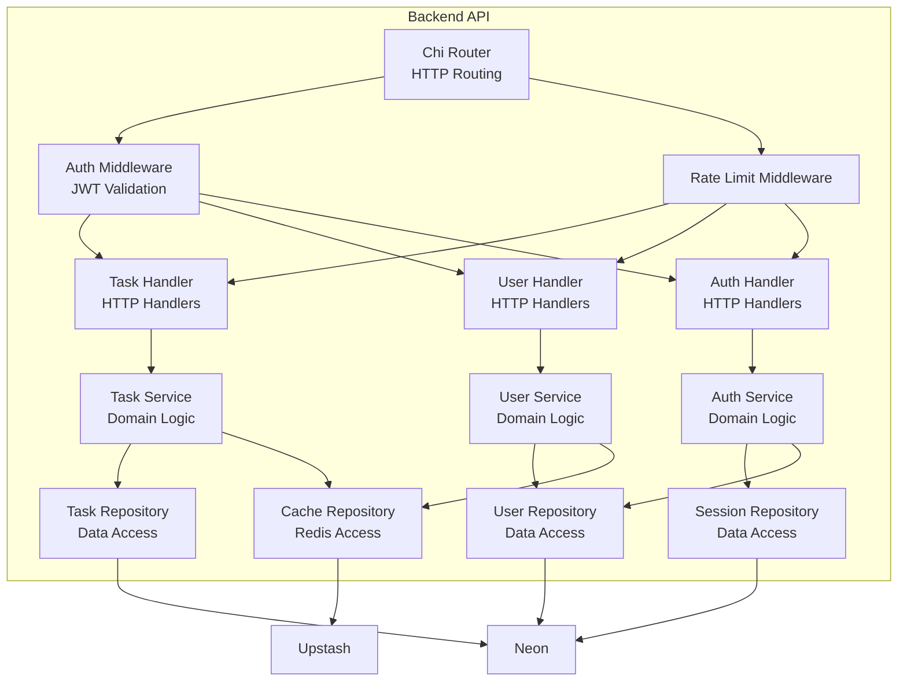
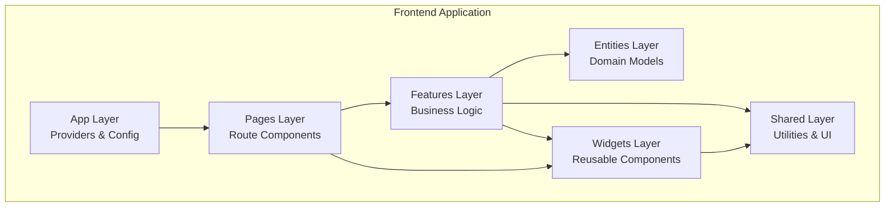
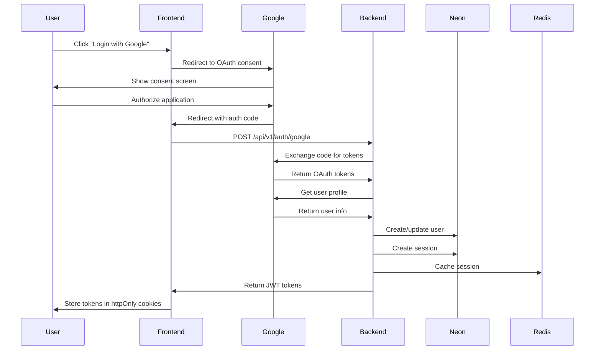
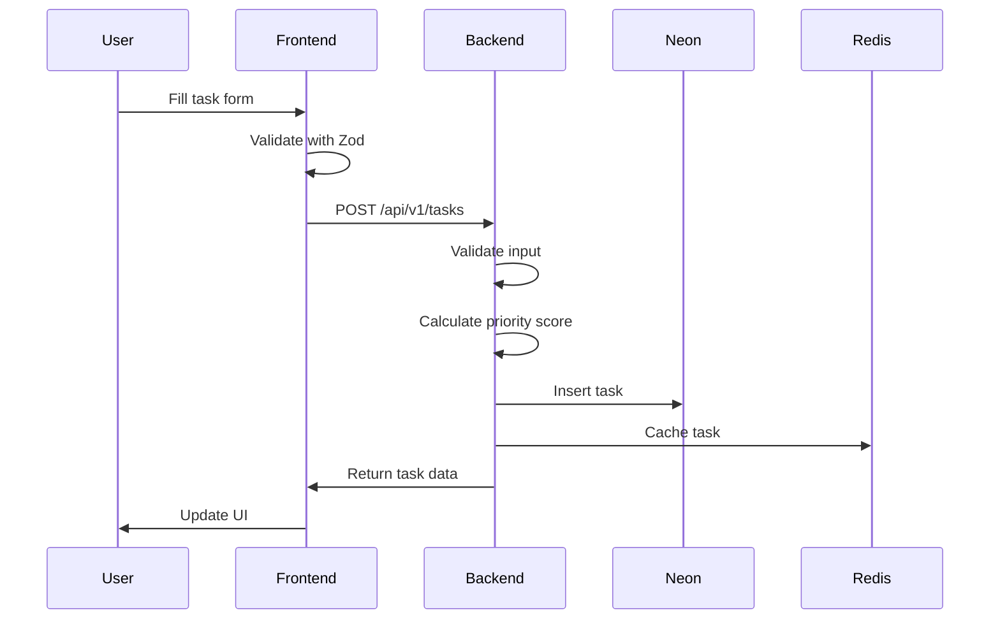
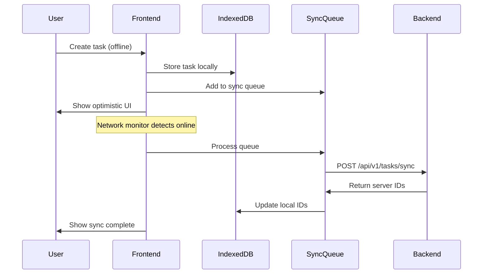

# System Overview

**Version**: 1.0
**Date**: 2026-11-09
**Status**: Draft

---

## Context Diagram (C4 Level 1)



### External Systems

| System | Type | Description |
|--------|------|-------------|
| **User** | Person | End users accessing the application via web browser |
| **Google OAuth** | External Service | Authentication provider for user login |
| **Neon PostgreSQL** | Database | Managed PostgreSQL database with branch-first workflow |
| **Upstash Redis** | Cache | Managed Redis for caching layer |
| **VM Storage** | Storage | 200GB OCI VM storage for media files |

---

## Container Diagram (C4 Level 2)

```mermaid
graph TB
    subgraph "Client Layer"
        Browser[Web Browser<br/>Chrome/Firefox/Safari]
        PWA[PWA Client<br/>Offline Support]
    end

    subgraph "Edge Layer"
        CDN[Cloudflare CDN<br/>Global Edge Network]
        Workers[Cloudflare Workers<br/>SvelteKit Adapter]
    end

    subgraph "Application Layer"
        Nginx[Nginx<br/>Reverse Proxy]
        Backend[Backend API<br/>Go + Chi Router]
    end

    subgraph "Data Layer"
        Neon[(Neon PostgreSQL<br/>Production Branch)]
        NeonTest[(Neon PostgreSQL<br/>Testing Branch)]
        Upstash[(Upstash Redis<br/>Cache Layer)]
        IndexedDB[(IndexedDB<br/>Browser Storage)]
    end

    subgraph "Infrastructure Layer"
        OCI[OCI Instance<br/>A1.Flex 2 OCPU 12GB]
        Forgejo[Forgejo CI/CD<br/>Self-hosted]
        GHCR[GitHub Container Registry<br/>Image Registry]
    end

    Browser -->|HTTPS| CDN
    PWA -->|HTTPS| CDN
    CDN -->|Static Assets| Workers
    Workers -->|REST API| Nginx
    Nginx -->|Proxy| Backend
    Backend -->|SQL| Neon
    Backend -->|SQL (Tests)| NeonTest
    Backend -->|Cache| Upstash
    PWA -->|Local Storage| IndexedDB
    Backend -->|File Links| VMStorage
    Backend -.->|Deploy| OCI
    Forgejo -->|Build & Push| GHCR
    OCI -->|Pull Images| GHCR
```

### Container Descriptions

| Container | Technology | Description |
|-----------|------------|-------------|
| **Web Browser** | Chrome/Firefox/Safari | User's web browser for accessing the application |
| **PWA Client** | Service Worker + IndexedDB | Progressive Web App with offline support |
| **Cloudflare CDN** | Cloudflare CDN | Global content delivery network for static assets |
| **Cloudflare Workers** | SvelteKit Adapter | Edge functions for frontend logic and API routing |
| **Nginx** | Nginx | Reverse proxy for backend API with SSL termination |
| **Backend API** | Go + Chi Router | RESTful API backend with DDD architecture |
| **Neon PostgreSQL** | PostgreSQL (Production) | Primary database for production data |
| **Neon PostgreSQL** | PostgreSQL (Testing) | Isolated database for testing (branch-first workflow) |
| **Upstash Redis** | Redis | Cache layer for frequently accessed data |
| **IndexedDB** | Browser API | Local storage for offline mode and guest users |
| **VM Storage** | OCI VM Storage | 200GB storage for media files (videos, photos) |
| **OCI Instance** | Podman + Debian 26 LTS | Production server with 2 OCPUs, 12GB RAM |
| **Forgejo CI/CD** | Forgejo Actions | Self-hosted CI/CD pipeline |
| **GitHub Container Registry** | GHCR | Container image registry |

---

## Component Diagram (C4 Level 3) - Backend



### Backend Component Descriptions

| Component | Responsibility |
|-----------|----------------|
| **Chi Router** | HTTP routing and request dispatching |
| **Auth Middleware** | JWT token validation and user authentication |
| **Rate Limit Middleware** | API rate limiting and throttling |
| **Task Handler** | HTTP request/response handling for tasks |
| **User Handler** | HTTP request/response handling for users |
| **Auth Handler** | HTTP request/response handling for authentication |
| **Task Service** | Business logic for task operations |
| **User Service** | Business logic for user operations |
| **Auth Service** | Business logic for authentication operations |
| **Task Repository** | Data access for tasks (SQLBoiler + PostgreSQL) |
| **User Repository** | Data access for users (SQLBoiler + PostgreSQL) |
| **Session Repository** | Data access for sessions (SQLBoiler + PostgreSQL) |
| **Cache Repository** | Cache operations (Redis) |

---

## Component Diagram (C4 Level 3) - Frontend



### Frontend Layer Descriptions

| Layer | Responsibility |
|-------|----------------|
| **App Layer** | Global providers, routing, configuration, theme |
| **Pages Layer** | Page-level components and route-specific logic |
| **Features Layer** | Feature-specific business logic, API integration, UI |
| **Entities Layer** | Domain entities and shared business logic |
| **Shared Layer** | Utilities, API clients, validation, shared UI components |
| **Widgets Layer** | Reusable UI components with their own logic |

---

## Data Flow Diagrams

### Authentication Flow



### Task Creation Flow



### Offline Sync Flow



---

## Technology Stack Overview

### Frontend
- **Framework**: SvelteKit
- **Language**: TypeScript (strict mode)
- **Runtime**: Bun
- **Architecture**: Feature-Sliced Design (FSD) + Vertical Slices
- **Styling**: Tailwind CSS
- **Validation**: Zod
- **Deployment**: Cloudflare Workers edge

### Backend
- **Language**: Go
- **Framework**: Chi (idiomatic HTTP router)
- **Architecture**: Domain-Driven Design (DDD) + Vertical Slices
- **ORM**: SQLBoiler
- **API Spec**: OpenAPI (oapi-codegen)
- **Deployment**: OCI Instance (Podman + Nginx)

### Infrastructure
- **Database**: Neon (PostgreSQL with branch-first workflow)
- **Cache**: Upstash (Redis)
- **CDN**: Cloudflare CDN
- **CI/CD**: Forgejo (self-hosted)
- **Container Registry**: GitHub Container Registry (GHCR)
- **Monitoring**: Grafana (Free tier)

---

## Non-Functional Requirements

### Performance
- Page load time < 2 seconds
- API response time < 200ms (p95)
- Support 10,000 concurrent users

### Availability
- 99.5% uptime target
- Graceful degradation
- Error handling and recovery

### Security
- OWASP compliance
- JWT-based authentication
- TLS 1.3 in transit
- Encryption at rest (Neon managed PostgreSQL)

### Scalability
- Horizontal scaling capability
- Database connection pooling
- Redis caching layer
- CDN for static assets

---

## References

- [Product Requirements Document](../prd.md) - Detailed product specifications
- [Backend Technical Design](../backend-spec/README.md) - Backend architecture details
- [Frontend Technical Design](../frontend-spec/README.md) - Frontend architecture details
- [Infrastructure & Network](./infrastructure-&-network.md) - Detailed infrastructure setup
- [Security & Compliance](./security-&-compliance.md) - Security architecture
