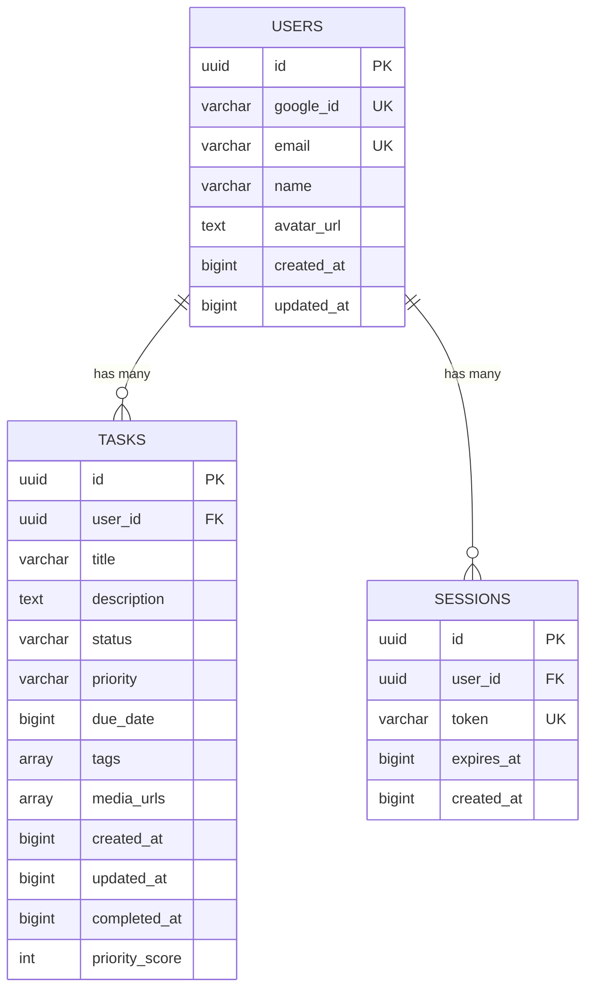

# Database Schema

**Version**: 1.0
**Date**: 2026-11-09
**Status**: Draft

---

## Overview

This document describes the database schema, entity relationships, migration rules, and caching strategy for the Advanced Task Manager backend.

---

## Database Configuration

### Database Instances

| Environment | Database Name | Neon Branch | Purpose |
|-------------|---------------|-------------|---------|
| **Production** | `taskmanager_db` | `main` | Live production data |
| **Testing** | `taskmanager_db_testing` | `testing` | Isolated test data |
| **Development** | `taskmanager_db_dev` | `dev` | Local development data |

**Branch-First Workflow:**
- Production branch (`main`) is never modified directly by tests
- Testing branch (`testing`) is used for all test environments
- Development branch (`dev`) is used for local development
- Changes are merged from dev → testing → main

### Connection Details

**Production:**
```
Host: ep-xxx.aws.neon.tech
Database: taskmanager_db
User: taskmanager_owner
SSL Mode: require
Connection Pool: pgxpool
Max Connections: 20
Min Connections: 5
```

**Testing:**
```
Host: ep-xxx.aws.neon.tech
Database: taskmanager_db_testing
User: taskmanager_testing_owner
SSL Mode: require
Connection Pool: pgxpool
Max Connections: 10
Min Connections: 2
```

---

## Entity Relationship Diagram (ERD)



---

## Table Definitions

### Users Table

Stores user account information from Google OAuth.

```sql
CREATE TABLE users (
    id UUID PRIMARY KEY DEFAULT gen_random_uuid(),
    google_id VARCHAR(255) UNIQUE NOT NULL,
    email VARCHAR(255) UNIQUE NOT NULL,
    name VARCHAR(255) NOT NULL,
    avatar_url TEXT,
    created_at BIGINT NOT NULL,      -- Epoch time in milliseconds
    updated_at BIGINT NOT NULL       -- Epoch time in milliseconds
);

-- Indexes
CREATE INDEX idx_users_google_id ON users(google_id);
CREATE INDEX idx_users_email ON users(email);
CREATE INDEX idx_users_created_at ON users(created_at DESC);

-- Triggers
CREATE OR REPLACE FUNCTION update_updated_at_column()
RETURNS TRIGGER AS $$
BEGIN
    NEW.updated_at = EXTRACT(EPOCH FROM NOW()) * 1000;
    RETURN NEW;
END;
$$ language 'plpgsql';

CREATE TRIGGER update_users_updated_at BEFORE UPDATE ON users
    FOR EACH ROW EXECUTE FUNCTION update_updated_at_column();
```

**Constraints:**
- `google_id`: Unique, from Google OAuth
- `email`: Unique, from Google OAuth
- `name`: Required, from Google OAuth

**Indexes:**
- `idx_users_google_id`: Fast lookup by Google ID
- `idx_users_email`: Fast lookup by email
- `idx_users_created_at`: For sorting by creation date

### Tasks Table

Stores task information for users.

```sql
CREATE TABLE tasks (
    id UUID PRIMARY KEY DEFAULT gen_random_uuid(),
    user_id UUID NOT NULL REFERENCES users(id) ON DELETE CASCADE,
    title VARCHAR(200) NOT NULL,
    description TEXT,
    status VARCHAR(50) DEFAULT 'todo' CHECK (status IN ('todo', 'in-progress', 'completed')),
    priority VARCHAR(50) DEFAULT 'medium' CHECK (priority IN ('low', 'medium', 'high', 'urgent')),
    due_date BIGINT,                  -- Epoch time in milliseconds
    tags TEXT[],                      -- Array of tags
    media_urls TEXT[],                -- Array of VM storage file paths/URLs
    created_at BIGINT NOT NULL,      -- Epoch time in milliseconds
    updated_at BIGINT NOT NULL,      -- Epoch time in milliseconds
    completed_at BIGINT,              -- Epoch time in milliseconds (nullable)
    priority_score INTEGER DEFAULT 0
);

-- Indexes
CREATE INDEX idx_tasks_user_id ON tasks(user_id);
CREATE INDEX idx_tasks_status ON tasks(status);
CREATE INDEX idx_tasks_priority ON tasks(priority);
CREATE INDEX idx_tasks_due_date ON tasks(due_date);
CREATE INDEX idx_tasks_created_at ON tasks(created_at DESC);
CREATE INDEX idx_tasks_priority_score ON tasks(priority_score DESC);
CREATE INDEX idx_tasks_tags ON tasks USING GIN(tags);

-- Triggers
CREATE TRIGGER update_tasks_updated_at BEFORE UPDATE ON tasks
    FOR EACH ROW EXECUTE FUNCTION update_updated_at_column();
```

**Constraints:**
- `user_id`: Foreign key to users table, cascade delete
- `title`: Required, max 200 characters
- `status`: Enum-like check constraint
- `priority`: Enum-like check constraint

**Indexes:**
- `idx_tasks_user_id`: Fast lookup by user
- `idx_tasks_status`: Filter by status
- `idx_tasks_priority`: Filter by priority
- `idx_tasks_due_date`: Filter by due date
- `idx_tasks_created_at`: Sort by creation date
- `idx_tasks_priority_score`: Sort by priority score
- `idx_tasks_tags`: GIN index for array operations

### Sessions Table

Stores user sessions for JWT authentication.

```sql
CREATE TABLE sessions (
    id UUID PRIMARY KEY DEFAULT gen_random_uuid(),
    user_id UUID NOT NULL REFERENCES users(id) ON DELETE CASCADE,
    token VARCHAR(500) UNIQUE NOT NULL,
    expires_at BIGINT NOT NULL,       -- Epoch time in milliseconds
    created_at BIGINT NOT NULL        -- Epoch time in milliseconds
);

-- Indexes
CREATE INDEX idx_sessions_user_id ON sessions(user_id);
CREATE INDEX idx_sessions_token ON sessions(token);
CREATE INDEX idx_sessions_expires_at ON sessions(expires_at);
```

**Constraints:**
- `user_id`: Foreign key to users table, cascade delete
- `token`: Unique, JWT refresh token hash
- `expires_at`: Required, epoch milliseconds

**Indexes:**
- `idx_sessions_user_id`: Fast lookup by user
- `idx_sessions_token`: Fast lookup by token
- `idx_sessions_expires_at`: For cleaning expired sessions

---

## Migration Rules

### Migration File Naming

**Format:** `YYYYMMDDHHMMSS_description.sql`

**Examples:**
- `20231109120000_create_users_table.sql`
- `20231109120001_create_tasks_table.sql`
- `20231109120002_create_sessions_table.sql`
- `20231109120003_add_task_tags_index.sql`

### Migration Workflow

**Development:**
- Create new migration with goose CLI
- Run migrations on dev branch
- Rollback migrations if needed

**Testing:**
- Run migrations on testing branch
- Reset testing database after tests

**Production:**
- Review migration
- Test migration on testing branch
- Create production migration
- Get approval from team
- Run migration on production branch (main)

### Migration Best Practices

**DO ✅:**
- Write reversible migrations (always provide down migration)
- Test migrations on testing branch before production
- Use transactions for complex migrations
- Add indexes after data migration (for performance)
- Document breaking changes in PR description

**DON'T ❌:**
- Don't drop columns without data migration
- Don't change column types without data migration
- Don't remove constraints without approval
- Don't run migrations directly on production without testing
- Don't forget to update ORM models after schema changes

---

## Caching Strategy

### Cache Layer (Upstash Redis)

**Cache Configuration:**
- **Provider**: Upstash Redis
- **Mode**: Redis Cluster (multi-region)
- **Persistence**: AOF (Append Only File)
- **Eviction Policy**: allkeys-lru (least recently used)
- **Max Memory**: 256MB

### Cache Keys

**Naming Convention:** `resource:id:field` or `resource:id`

**Examples:**
- `task:12345` - Full task object
- `task:12345:title` - Task title only
- `user:67890` - Full user object
- `user:67890:email` - User email only
- `session:abc123` - Session data

### Cache TTL (Time To Live)

| Resource | TTL | Reason |
|----------|-----|--------|
| **Task** | 1 hour | Tasks change frequently |
| **User** | 24 hours | User data changes infrequently |
| **Session** | 7 days | Session expiration |
| **Priority Score** | 1 hour | Recalculated periodically |
| **Task List** | 5 minutes | List changes frequently |

### Cache Operations

**Read Through Cache:**
- Try cache first with resource key
- Return cached data if available
- On cache miss, query database
- Update cache with fetched data
- Return data

**Write Through Cache:**
- Update database first
- Update cache with new data
- Return error if database update fails

**Cache Invalidation:**
- Delete from database
- Invalidate cache entry
- Return error if database delete fails

### Cache Warmup

**On Application Startup:**
- Retrieve frequently accessed tasks (limit 100)
- Cache each task with appropriate TTL
- Return error if retrieval or caching fails

---

## Data Validation

### Database-Level Validation

**Check Constraints:**
```sql
-- Task status validation
ALTER TABLE tasks
ADD CONSTRAINT chk_status
CHECK (status IN ('todo', 'in-progress', 'completed'));

-- Task priority validation
ALTER TABLE tasks
ADD CONSTRAINT chk_priority
CHECK (priority IN ('low', 'medium', 'high', 'urgent'));

-- Due date validation (must be future if set)
ALTER TABLE tasks
ADD CONSTRAINT chk_due_date
CHECK (due_date IS NULL OR due_date > EXTRACT(EPOCH FROM NOW()) * 1000);
```

**Trigger Validation:**
```sql
-- Ensure title is not empty
CREATE OR REPLACE FUNCTION validate_task_title()
RETURNS TRIGGER AS $$
BEGIN
    IF NEW.title = '' OR NEW.title IS NULL THEN
        RAISE EXCEPTION 'Task title cannot be empty';
    END IF;
    RETURN NEW;
END;
$$ language 'plpgsql';

CREATE TRIGGER validate_task_title BEFORE INSERT OR UPDATE ON tasks
    FOR EACH ROW EXECUTE FUNCTION validate_task_title();
```

### Application-Level Validation

**Go Validator:**
```go
type CreateTaskRequest struct {
    Title       string   `json:"title" validate:"required,min=1,max=200"`
    Description string   `json:"description" validate:"max=5000"`
    Status      string   `json:"status" validate:"required,oneof=todo in-progress completed"`
    Priority    string   `json:"priority" validate:"required,oneof=low medium high urgent"`
    DueDate     int64    `json:"due_date" validate:"omitempty,min=0"`
    Tags        []string `json:"tags" validate:"omitempty,max=10,dive,min=1,max=50"`
}
```

---

## Backup & Recovery

### Automated Backups (Neon)

- **Frequency**: Daily
- **Retention**: 7 days (standard), 30 days (extended)
- **Backup Type**: Full database backup
- **Storage**: Neon-managed storage (encrypted)

### Point-in-Time Recovery

- **Granularity**: Per-second recovery up to 7 days
- **Usage**: Restore to specific timestamp
- **Cost**: Included in Neon plan

### Backup Verification

**Monthly:**
- Restore database from backup to testing branch
- Verify data integrity
- Test application functionality

---

## References

- [Backend Technical Design](./README.md) - Backend architecture overview
- [SQLBoiler Documentation](https://github.com/volatiletech/sqlboiler) - ORM documentation
- [Neon Documentation](https://neon.tech/docs) - Database documentation
- [Upstash Documentation](https://upstash.com/docs) - Cache documentation
