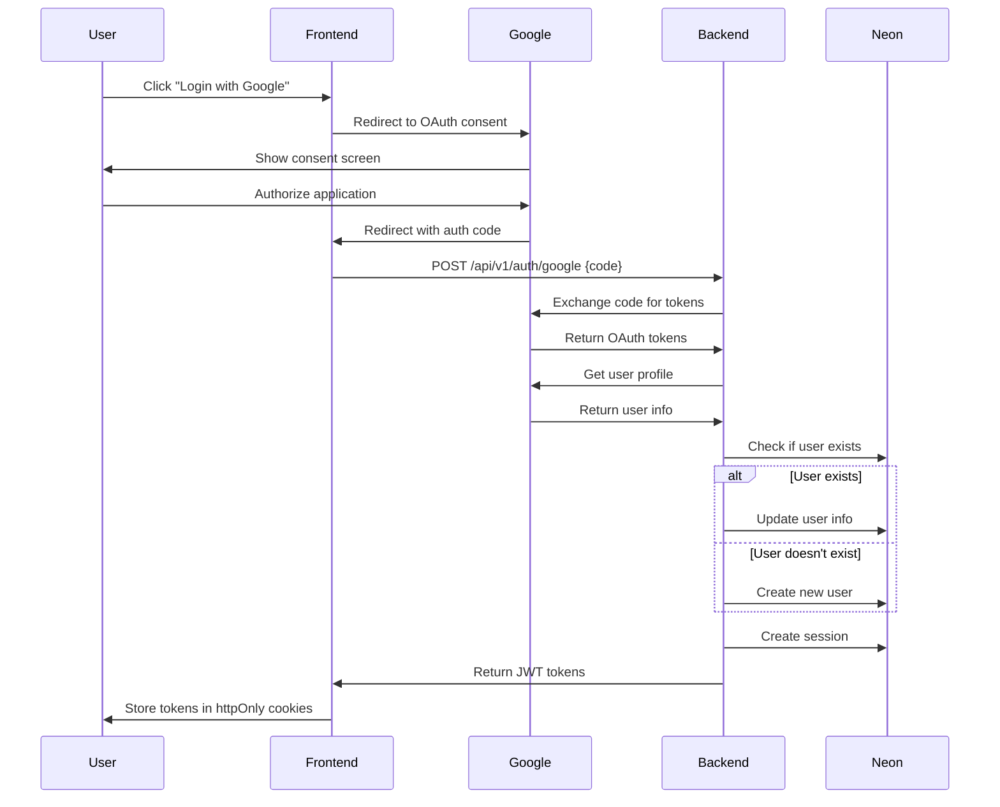

# Auth Service Design

**Version**: 1.0
**Date**: 2026-11-09
**Status**: Draft

---

## Overview

This document describes the authentication service design, including Google OAuth integration, JWT token management, and session handling.

---

## Authentication Flow

### Google OAuth 2.0

**Flow Diagram:**

### Endpoints

| Endpoint | Method | Description |
|----------|--------|-------------|
| `/api/v1/auth/google` | POST | Exchange OAuth code for JWT tokens |
| `/api/v1/auth/refresh` | POST | Refresh access token |
| `/api/v1/auth/logout` | POST | Logout and invalidate session |
| `/api/v1/auth/me` | GET | Get current user info |

---

## JWT Token Management

### Token Structure

**Access Token (15 minutes):**
- Issuer: taskmanager-api
- Subject: user-id
- Audience: taskmanager-frontend
- Claims: email, name

**Refresh Token (7 days):**
- Issuer: taskmanager-api
- Subject: user-id
- Audience: taskmanager-frontend
- Type: refresh

### Token Generation

- TokenService struct with secret key
- GenerateAccessToken method with user claims
- GenerateRefreshToken method with refresh type
- Use HMAC-SHA256 signing method
- Set appropriate expiration times

### Token Validation

- Parse token with secret key validation
- Verify signing method
- Check token validity
- Reject refresh tokens as access tokens
- Return claims on successful validation

---

## Session Management

### Session Creation

- Generate refresh token using TokenService
- Hash refresh token for secure storage using SHA256
- Create session with user ID, token hash, and expiration
- Save session to repository
- Return session on success

### Session Validation

- Hash incoming refresh token
- Find session by token hash in repository
- Check if session is expired against current timestamp
- Return session on successful validation
- Return error if session not found or expired

### Session Cleanup

**Automatic cleanup:**
- Clean up expired sessions hourly (via background job)
- Delete sessions on logout
- Delete sessions on user account deletion

---

## Security Considerations

### Token Storage

**Frontend:**
- Access token: Memory (session storage)
- Refresh token: httpOnly, secure, sameSite cookie

**Backend:**
- Session record in PostgreSQL with refresh token hash
- Token expiration tracking
- Automatic token revocation on logout

### Token Rotation

**On Refresh:**
- Issue new access token
- Issue new refresh token
- Invalidate old refresh token
- Update session record

### Rate Limiting

**Authentication Endpoints:**
- 10 requests per minute per IP
- 20 requests per minute per user
- Block repeated failed attempts

---

## References

- [Backend Technical Design](./README.md) - Backend architecture overview
- [Google OAuth Documentation](https://developers.google.com/identity/protocols/oauth2) - OAuth 2.0 documentation
- [JWT Documentation](https://jwt.io/) - JWT documentation
