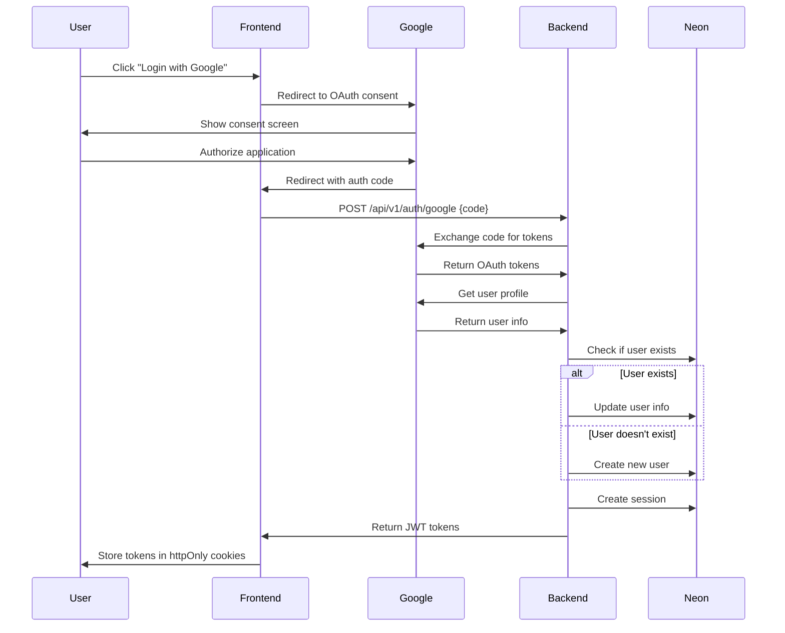

# Auth Service Design

**Version**: 1.0
**Date**: 2026-11-09
**Status**: Draft

---

## Overview

This document describes the authentication service design, including Google OAuth integration, JWT token management, and session handling.

---

## Authentication Flow

### Google OAuth 2.0

**Flow Diagram:**


### Endpoints

| Endpoint | Method | Description |
|----------|--------|-------------|
| `/api/v1/auth/google` | POST | Exchange OAuth code for JWT tokens |
| `/api/v1/auth/refresh` | POST | Refresh access token |
| `/api/v1/auth/logout` | POST | Logout and invalidate session |
| `/api/v1/auth/me` | GET | Get current user info |

---

## JWT Token Management

### Token Structure

**Access Token (15 minutes):**
```json
{
  "iss": "taskmanager-api",
  "sub": "user-id",
  "aud": "taskmanager-frontend",
  "exp": 1726653300,
  "iat": 1726652400,
  "email": "user@example.com",
  "name": "John Doe"
}
```

**Refresh Token (7 days):**
```json
{
  "iss": "taskmanager-api",
  "sub": "user-id",
  "aud": "taskmanager-frontend",
  "exp": 1727257200,
  "iat": 1726652400,
  "type": "refresh"
}
```

### Token Generation

```go
package auth

import (
    "time"
    "github.com/golang-jwt/jwt/v5"
)

type TokenService struct {
    secretKey []byte
}

func NewTokenService(secretKey string) *TokenService {
    return &TokenService{secretKey: []byte(secretKey)}
}

func (s *TokenService) GenerateAccessToken(userID, email, name string) (string, error) {
    now := time.Now()
    claims := jwt.MapClaims{
        "iss":   "taskmanager-api",
        "sub":   userID,
        "aud":   "taskmanager-frontend",
        "exp":   now.Add(15 * time.Minute).Unix(),
        "iat":   now.Unix(),
        "email": email,
        "name":  name,
    }

    token := jwt.NewWithClaims(jwt.SigningMethodHS256, claims)
    return token.SignedString(s.secretKey)
}

func (s *TokenService) GenerateRefreshToken(userID string) (string, error) {
    now := time.Now()
    claims := jwt.MapClaims{
        "iss":   "taskmanager-api",
        "sub":   userID,
        "aud":   "taskmanager-frontend",
        "exp":   now.Add(7 * 24 * time.Hour).Unix(),
        "iat":   now.Unix(),
        "type":  "refresh",
    }

    token := jwt.NewWithClaims(jwt.SigningMethodHS256, claims)
    return token.SignedString(s.secretKey)
}
```

### Token Validation

```go
func (s *TokenService) ValidateAccessToken(tokenString string) (*jwt.MapClaims, error) {
    token, err := jwt.Parse(tokenString, func(token *jwt.Token) (interface{}, error) {
        if _, ok := token.Method.(*jwt.SigningMethodHMAC); !ok {
            return nil, fmt.Errorf("unexpected signing method: %v", token.Header["alg"])
        }
        return s.secretKey, nil
    })

    if err != nil {
        return nil, err
    }

    if claims, ok := token.Claims.(jwt.MapClaims); ok && token.Valid {
        if claims["type"] == "refresh" {
            return nil, fmt.Errorf("refresh token cannot be used as access token")
        }
        return &claims, nil
    }

    return nil, fmt.Errorf("invalid token")
}
```

---

## Session Management

### Session Creation

```go
package auth

import (
    "context"
    "crypto/rand"
    "encoding/hex"
    "time"
)

type SessionService struct {
    sessionRepo Repository
    tokenService *TokenService
}

func (s *SessionService) CreateSession(ctx context.Context, userID string) (*Session, error) {
    // Generate refresh token
    refreshToken, err := s.tokenService.GenerateRefreshToken(userID)
    if err != nil {
        return nil, err
    }

    // Hash refresh token for storage
    tokenHash := hashToken(refreshToken)

    // Create session
    now := time.Now().UnixMilli()
    session := &Session{
        ID:        generateUUID(),
        UserID:    userID,
        Token:     tokenHash,
        ExpiresAt: now + (7 * 24 * 60 * 60 * 1000), // 7 days
        CreatedAt: now,
    }

    // Save session
    if err := s.sessionRepo.Create(ctx, session); err != nil {
        return nil, err
    }

    return session, nil
}

func hashToken(token string) string {
    h := sha256.New()
    h.Write([]byte(token))
    return hex.EncodeToString(h.Sum(nil))
}
```

### Session Validation

```go
func (s *SessionService) ValidateSession(ctx context.Context, refreshToken string) (*Session, error) {
    // Hash refresh token
    tokenHash := hashToken(refreshToken)

    // Find session by token hash
    session, err := s.sessionRepo.FindByToken(ctx, tokenHash)
    if err != nil {
        return nil, err
    }

    // Check if session is expired
    now := time.Now().UnixMilli()
    if session.ExpiresAt < now {
        return nil, ErrSessionExpired
    }

    return session, nil
}
```

### Session Cleanup

**Automatic cleanup:**
- Clean up expired sessions hourly (via background job)
- Delete sessions on logout
- Delete sessions on user account deletion

---

## Security Considerations

### Token Storage

**Frontend:**
- Access token: Memory (session storage)
- Refresh token: httpOnly, secure, sameSite cookie

**Backend:**
- Session record in PostgreSQL with refresh token hash
- Token expiration tracking
- Automatic token revocation on logout

### Token Rotation

**On Refresh:**
- Issue new access token
- Issue new refresh token
- Invalidate old refresh token
- Update session record

### Rate Limiting

**Authentication Endpoints:**
- 10 requests per minute per IP
- 20 requests per minute per user
- Block repeated failed attempts

---

## References

- [Backend Technical Design](./README.md) - Backend architecture overview
- [Google OAuth Documentation](https://developers.google.com/identity/protocols/oauth2) - OAuth 2.0 documentation
- [JWT Documentation](https://jwt.io/) - JWT documentation
